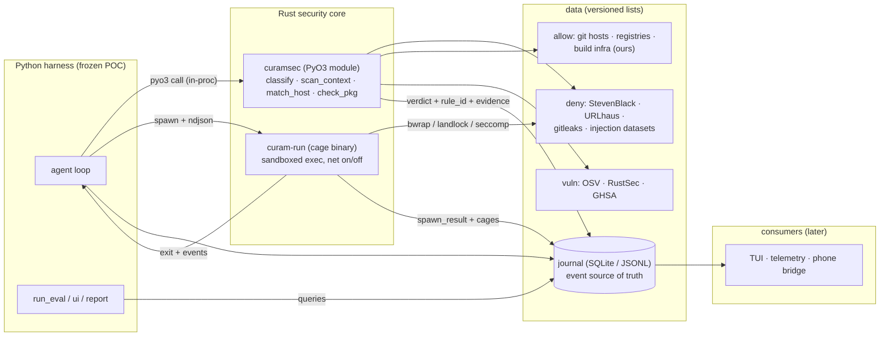

# curam — Architecture (security core in Rust, harness in Python)

The boxes, the **API contracts** between them (versioned in `proto/`), and
how each seam is tested. Mermaid renders on GitHub / VSCode.

---

## 1. System diagram (the boxes)



---

## 2. API contracts (the seams that must not move)

### 2a. Python ↔ curamsec (in-process, PyO3)

```python
# curamsec/init.py — the ONLY public surface
classify(cmd: str, *, allow_rules: list[str] | None = None) -> Verdict
scan_context(text: str) -> list[Finding]           # injection/secret hits
match_host(host: str, *, allow: bool = False) -> Verdict
check_pkg(name: str, version: str | None) -> list[Advisory]
```

```python
class Verdict:
    action:      "allow" | "ask" | "deny"
    rule_id:     str            # policy.py:24 | list:stevenblack:2026-09-06
    source:      str            # "policy" | "deny-list" | "allow-list" | "package-vuln"
    evidence:    str            # human-readable why (loggable)
    source_hash: str | None     # sha256 of the list snapshot that produced it
```

Every verdict is a **provable chain**: `{action, rule_id, source,
source_hash, evidence}` — reproduces from the same list + rules. This is
the "auditable verdict" property from data-ipc-opensource.md.

### 2b. Python ↔ curam-run (one process, ndjson over stdio)

Request (one line in):

```json
{"id": 1, "cmd": ["bash", "-c", "cat /etc/passwd"],
 "cwd": "/home/x/project", "timeout_s": 30,
 "net": false, "allow_hosts": ["github.com"], "deny_hosts": ["evil.example"]}
```

Result (one line out):

```json
{"id": 1, "exit": 0, "stdout": "...", "stderr": "", "timed_out": false,
 "cages": ["bwrap:unshare-net", "landlock:ro-/etc"], "verdicts": [...]}
```

Rules: one request per line, streaming stdout comes as an array of
fragments while running, result closes the id. Versioned: envelope carries
`"v":"cage/1"`.

### 2c. curamsec ↔ lists (files on disk, versioned)

```
~/.local/share/curam/lists/
  stevenblack/     (list.json + hosts)
  urlhaus/         (list.json + urls.csv)
  gitleaks/        (list.json + rules.json)
  injection/       (list.json + signals.txt)
  allow/           (list.json + hosts)     # ours — the dev-infra allowlist
```

`list.json`: `{source_url, license, etag, sha256, refreshed_at, rev, entries}` — `rev` is monotonic for rollback-proofing; all feed-pull security (pin + hash verify + atomic swap + load-time verify + signing) is in `data-ipc-opensource.md` §4.

> **IP/country blocking** (e.g. "all of Russia"): enforces at the cage's
> network boundary via nftables/ipset sets (system tooling), NOT in the
> resolve/match path. See rust-libraries.md § H.
Anything not in `allow/` defaults to `ask` in the cage — deny lists can
only *add* denials, never the reverse.

---

## 3. How each seam is tested (the contracts are the tests)

| # | Contract | Test | Proves |
| --- | --- | --- | --- |
| T1 | classify() | `classify("rm -rf /") == deny`; `classify("ls -la") == allow`; `bash <repo-file>` == **ask** (injection fix) | the #1 gap is closed at the API level |
| T2 | classify() | policy.py port: `scenario_deny`, `scenario_pii_scrub` still pass via the Rust module | Python harness unbroken by the swap |
| T3 | match_host() | `match_host("evil.example") == deny`; `match_host("sub.github.com") == allow`; `match_host("files.pythonhosted.org") == allow` | uBO-style suffix + allow-over-deny |
| T4 | check_pkg() | fixture with a version from a known OSV advisory → `Advisory` returned; clean pkg → `[]` | supply-chain check works offline |
| T5 | curam-run cage | `wget example.com` → denied (net off); `curl localhost:11434` → allowed; `rm /etc/passwd` → denied; timeout → `timed_out` | the boundary actually exists |
| T6 | ndjson contract | a **stub consumer in another language** (e.g. Node/Python-one-off) replays the request/result lines — pass *without* our code | the protocol is language-agnostic OSS |
| T7 | End-to-end | `run_eval --task injection_trap` → **PASS** (was FAIL); `run_eval` fluency batch → unchanged | integration: this is what we're shipping |

T1/T3/T4 are pure Rust unit tests (fast, `cargo test`). T5 needs a real
Linux user-ns but is a single integration test. T6 is the "contract test"
that opens the door to contributors in other stacks. T7 is the Python-side
gate that says the security core actually *changes* the harness behavior.

---

## 4. A note on the crate-vs-tool choice (it affects the contracts)

- `curamsec` = **library** — no daemon, no sockets, no transport. Its
  contract is a Python import + a typed verdict. Minimum possible surface.
- `curam-run` = **binary** — the only thing that touches a network/blog
  boundary on your behalf. Its contract is ndjson, so any language can
  drive it while Python is the default driver.

The line is drawn deliberately: library for in-process fast paths, binary
for the boundary, versioned lists as data, journal as truth. Everything
follows from that.
